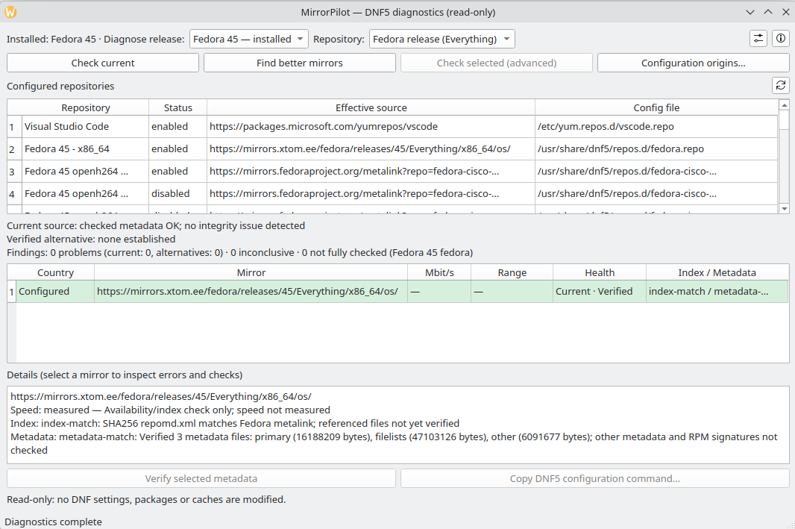
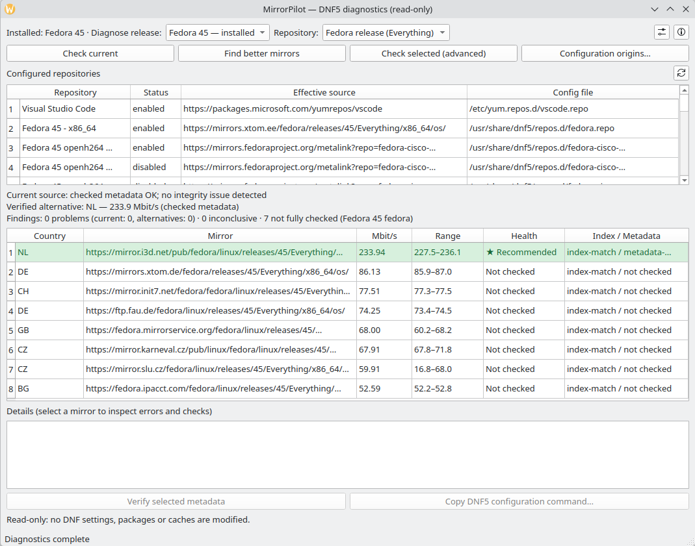
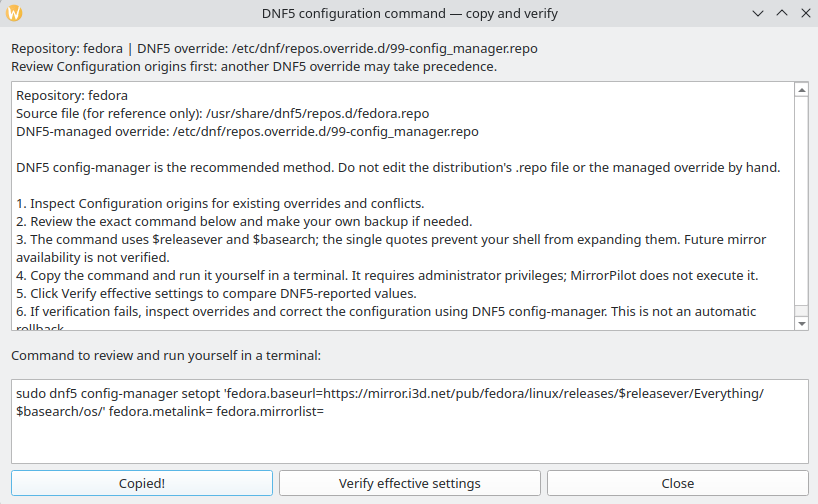
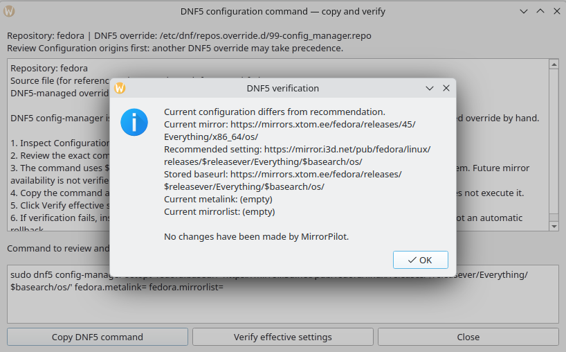
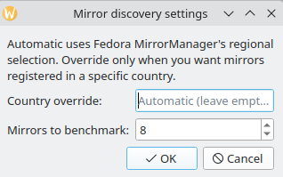

# MirrorPilot

**Read-only Fedora DNF5 mirror diagnostics, with a graphical interface.**

MirrorPilot helps you investigate slow or broken Fedora repository mirrors, compare alternatives, and review a DNF5 configuration command **before deciding whether to run it yourself**. It does not install packages, change repositories, modify DNF caches, or request administrator privileges.

> **Status:** experimental alpha (`0.1.0a2`). The latest application and AppImage acceptance tests were performed on Fedora KDE 45 (Wayland); earlier diagnostic development and field tests also took place on Fedora 44. Other Fedora releases and environments need further validation. The project is not affiliated with the Fedora Project.



*Check current results.*



*Find better mirrors results.*


## Why MirrorPilot?

A mirror can respond quickly yet serve missing or inconsistent repository metadata. A configured mirror can also fail while another mirror works. MirrorPilot separates **availability**, **indicative transfer speed**, **repository index consistency**, and **referenced metadata checks**, instead of treating a fast response as proof of a healthy repository.

In a Fedora 44 field test, a configured updates mirror returned HTTP 404 for referenced metadata. A separately checked alternative provided consistent metadata, and DNF5 subsequently loaded the repositories and listed available updates. This is an example, not a guarantee that the same mirror will work for everyone.

## What it does

- **Inspect repositories:** show configured Fedora repositories and their effective DNF5 sources; inspect configuration origins and potential overrides.
- **Check current:** diagnose a configured, direct HTTPS `baseurl` without searching for alternatives.
- **Find better mirrors:** discover eligible mirrors through Fedora MirrorManager, measure bounded transfers, and compare repository indexes with the relevant Fedora metalink.
- **Verify selected metadata:** check selected referenced metadata files against digests in `repomd.xml`. A recommended alternative has passed the application's index and selected metadata checks.
- **Preview a DNF5 command:** generate a copyable, **user-run** command for a verified Fedora `fedora` or `updates` mirror, using `$releasever` and `$basearch` rather than locking the URL to one Fedora release.
- **Verify settings:** compare DNF5's effective values with the intended mirror and check that the saved URL remains variable-based.

The **Installed** Fedora version comes from the system; **Diagnose release** selects which release to inspect. Testing another release is allowed, but generating a configuration change for a release other than the installed one is blocked.

## Download the alpha AppImage

**MirrorPilot v0.1.0a2 (x86_64)** — [GitHub Releases](https://github.com/ollavarma-create/mirrorpilot/releases)

The new AppImage is **58,538,488 bytes (55.83 MiB)**, down from **279,595,512 bytes (266.64 MiB)** for the earlier locally built `0.1.0a1` AppImage. That is a **79.1% size reduction** (about **4.8× smaller**, saving **210.82 MiB**). These figures compare the specific tested artifacts, not necessarily every build of either version. The release is built through GitHub Actions with an automated headless startup smoke test; the latest functional and GUI tests were performed on **Fedora KDE 45 (Wayland)**. Earlier Fedora 44 field tests informed development, but compatibility with other Fedora versions is **not yet verified**.

**Release status:** The `v0.1.0a2` release asset will be available from GitHub Releases once the release is published. Until then, use the artifact from a successful manual GitHub Actions CI run. A CI artifact is a test build, not a published release.

MirrorPilot is intended for **Fedora Linux with a working DNF5 installation**. At startup it checks the operating system and DNF5 availability and reports unsupported environments rather than attempting repository diagnostics. It is not a general-purpose Linux mirror manager.

When the release is published, download `MirrorPilot-0.1.0a2-x86_64.AppImage` and `SHA256SUMS` from the **same release**, then run:

```bash
sha256sum -c SHA256SUMS
chmod +x MirrorPilot-0.1.0a2-x86_64.AppImage
./MirrorPilot-0.1.0a2-x86_64.AppImage
```

The checksum check should print `OK`. No administrator privileges or separate Python/PySide6 installation are needed to launch the AppImage. The SHA256 checksum verifies the downloaded bytes against the accompanying checksum file; obtain both files from the trusted release page.

**Alpha testers wanted:** If you try it on Fedora 43, 44, 45, or a newer Fedora release, please [open an issue](https://github.com/ollavarma-create/mirrorpilot/issues) with the Fedora version, desktop/session (Wayland or X11), whether the AppImage launches, and any non-sensitive error output. Reports of successful runs are useful too. Never paste credentials, private repository URLs, or other sensitive configuration data.

## Install and run

For **source installation**, use Fedora Linux with DNF5, Python 3.11+, and Qt/PySide6. The primary development and field-test environment is Fedora KDE. The AppImage download above does not require a separate Python or PySide6 installation.

From a clone of this repository:

```bash
python3 -m venv .venv
source .venv/bin/activate
python -m pip install -e .
mirrorpilot
```

To run automated tests, install the optional test dependencies (including `pytest`):

```bash
python -m pip install -e '.[test]'
python -m pytest -q
```

No separate `requirements.txt` is required: runtime and test dependencies are declared in `pyproject.toml`.

No `sudo` is needed to run MirrorPilot. If you already have a local checkout, update it with `git pull` before installing or running.

## Quick start

1. Select **Diagnose release** (normally the installed Fedora version) and **Repository** (`Fedora` / `Fedora updates`).
2. Click **Check current** to investigate your configured direct HTTPS source, or **Find better mirrors** to discover and compare alternatives.
3. Inspect the results and details. A fast mirror is not necessarily a verified mirror; only a checked alternative can be marked **Recommended**.
4. Select a verified alternative and click **Copy DNF5 configuration command…**. Read the command and inspect **Configuration origins…** before applying it.
5. If you choose to change the configuration, run the copied command **yourself** in a terminal, then use **Verify effective settings**.



*Review and copy the DNF5 command before making changes yourself.*

### Example: a manual DNF5 command

The following is **illustrative**, not a universal mirror recommendation. Use the URL from your own verified diagnostic result.

```bash
sudo dnf5 config-manager setopt \
  'updates.baseurl=https://mirror.example.org/fedora/linux/updates/$releasever/Everything/$basearch/' \
  updates.metalink= \
  updates.mirrorlist=
```

The single quotes preserve the DNF variables. DNF5's config-manager manages its override; do **not** manually edit the generated `99-config_manager.repo` as the normal workflow. MirrorPilot only displays and copies the command—it never executes it.

After a user-run change, you can check repository loading with:

```bash
dnf5 --refresh check-update
echo "DNF5 exit code: $?"
```

For `dnf5 check-update`, exit code **100** means updates are available, **0** means no updates are available, and **1** indicates an error. A working Fedora 44 mirror does not prove that the same server carries Fedora 45.



*Check effective DNF5 settings after running the command. Settings not changed in this example.*

### Change settings

You may override default country and set how many mirrors are tested in the settings dialog:



## What the results mean

| Result | Interpretation |
| --- | --- |
| **Measured speed** | Indicative performance of bounded sample transfers, not sustained package-download speed |
| **index-match** | The mirror's `repomd.xml` digest matched the Fedora metalink reference during the check |
| **metadata-match** | Selected referenced metadata files passed the digest checks |
| **Recommended** | An alternative passed the index and selected metadata checks; not a full security certification |
| **Current source: not tested** | The current source was not checked in this run, or no supported concrete HTTPS `baseurl` could be identified |
| **Different / unavailable / inconclusive** | Inspect the details; a changing repository, timeout, size cap, or synchronization delay can affect results |

**Important limitations:** The tool does not verify RPM signatures, establish publisher authenticity independently, check every metadata type, guarantee repository freshness, or certify future mirror availability. The mirror country is based on MirrorManager registry data, **not independent physical geolocation**. Discovery and network operations can time out. The current-source parser does not implement every libdnf5 precedence rule, and metalink-only sources are not directly tested as a configured base URL.

## Safety and scope

MirrorPilot is **read-only** with respect to the host's DNF configuration, installed packages, and caches. It uses network access for diagnostics and can download substantial metadata during explicit verification. By default, it verifies selected metadata for only the fastest index-matching alternative; additional checks require user action.

A diagnostic run for Fedora 45 on a Fedora 44 installation **does not** authorize pointing the Fedora 44 repositories at Fedora 45. Use Fedora's official release-upgrade procedure for distribution upgrades.

The repository includes **research-only** prototypes for privileged helpers, Polkit authentication, filesystem identity checks, and sandbox transactions. These are **not wired into the GUI**, are not production-safe writers, and must not be used to modify real `/etc` repository configuration.

## Tests and contributions

```bash
python -m pip install -e '.[test]'
python -m pytest -q
```

On Fedora 45, a recent local run completed with **262 passed, 1 skipped** (16 November 2026), before the additional DNF5 verification-message regression test was added. GitHub Actions also runs the automated tests and an Ubuntu-based, headless AppImage startup smoke test. The smoke test verifies startup and Qt loading, not Fedora-specific GUI functionality. These results are not a claim of exhaustive coverage.

Bug reports are especially welcome for DNF5 configuration differences, mirror discovery timeouts, Fedora release changes, and confusing diagnostic messages. Please include the Fedora release, steps to reproduce, and relevant non-sensitive logs.

## Technical documentation

- [Architecture and design](docs/DESIGN.md) — components, verification boundaries, DNF5 integration, and safety invariants.
- [Testing and field validation](docs/TESTING.md) — regression coverage, Fedora 44 case studies, and manual acceptance checks.

## Roadmap

Near-term priorities are documentation, reproducible field testing, clear diagnostic messages, and validation across Fedora releases. A production privileged writer is **not** planned as part of the current read-only workflow.

## License

GPL-3.0-only. See [LICENSE](LICENSE).
